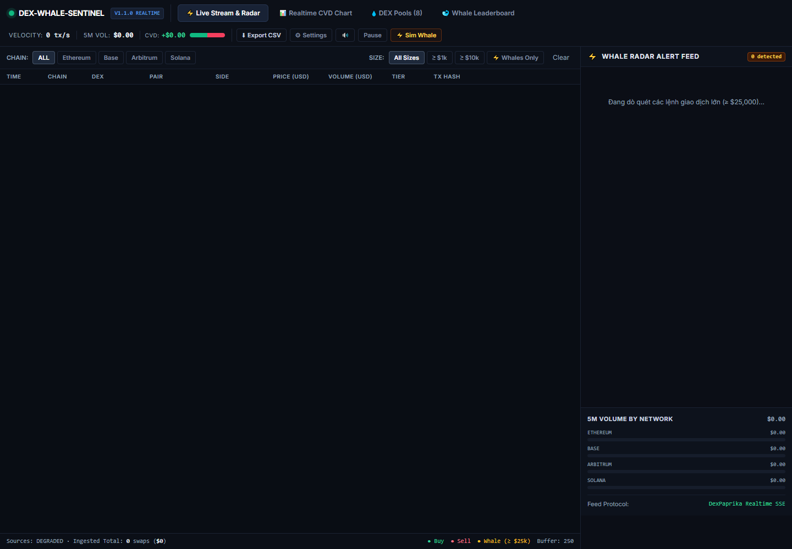

# DEX Whale Sentinel

[Tiếng Việt](README.md) · [English](README.en.md)

Tracks swaps from DexPaprika, groups trades by value and calculates CVD in a sliding window. FastAPI sends browser updates over WebSockets.



Actual current app. Source requests could not connect during capture, so the table is empty and Sources shows DEGRADED. The image does not demonstrate trade volume or processing throughput.

## Run

```sh
python -m venv .venv
# Activate the environment, then:
pip install -r requirements.txt
python -m pytest tests -v
python -m uvicorn src.main:app --host 127.0.0.1 --port 8000
```

Open http://localhost:8000. `GET /api/status` reports each pool's last success, latest error, consecutive failures and data age. DEGRADED means a source failed, became stale or reached the catch-up limit.

## Ingestion and limits

The HTTP client retries network errors, 429 and 5xx up to three times with backoff. A poll reads at most five pages and stops at a known transaction or the end. Reaching the limit marks the history as potentially incomplete; this cannot guarantee complete collection from busy pools or changing API pages.

Deduplication uses chain, pool and transaction ID in bounded RAM. Restarting loses that state; it is not durable exactly-once processing.

`POST /api/webhook/test` creates a preview and returns `delivered: false`. Telegram/Discord delivery is not implemented. Tests cover deduplication, classification, CVD, retries, recovery and catch-up limits using mocked HTTP; they send no external alerts.
