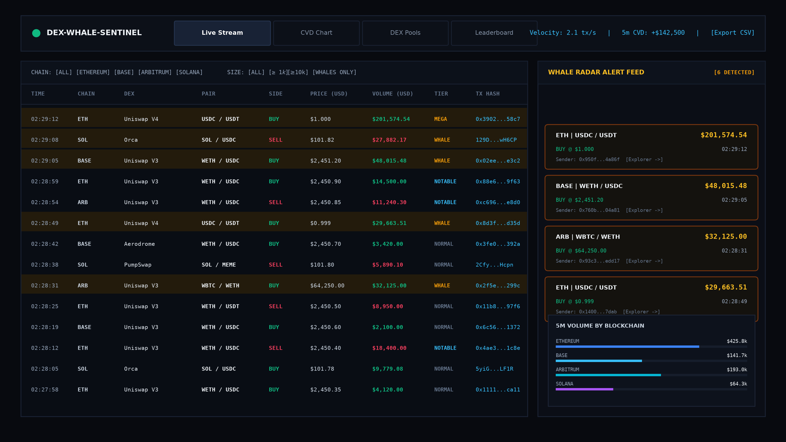
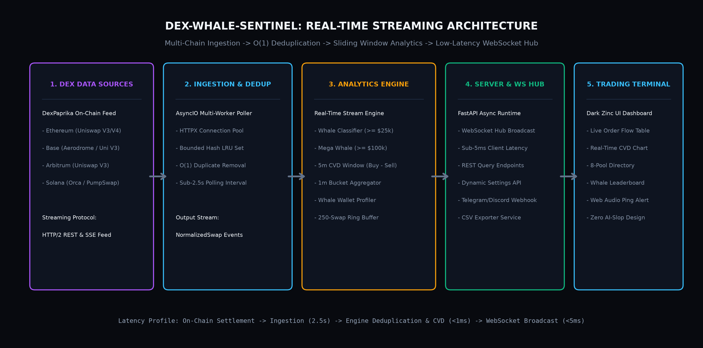
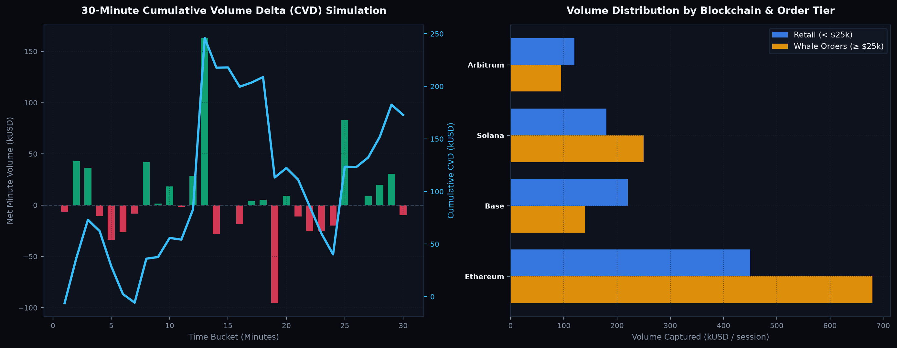

# DEX-Whale-Sentinel

[Tiếng Việt](#tiếng-việt) • [English](#english)

---

<a name="tiếng-việt"></a>
# TIẾNG VIỆT

Hệ thống thu thập, xử lý và giám sát luồng giao dịch Crypto DEX thời gian thực (Real-time Stream Pipeline) với độ trễ thấp, kết nối trực tiếp dữ liệu on-chain từ **DexPaprika API** (hỗ trợ Ethereum, Solana, Base, Arbitrum), phát hiện các lệnh cá voi (Whale Alert) và tính toán chỉ số chênh lệch khối lượng mua/bán (Cumulative Volume Delta - CVD) trên cửa sổ trượt (Sliding Window).




---

## 1. Kiến Trúc Hệ Thống (Architecture)



```text
DexPaprika API (REST / SSE)
[Ethereum, Solana, Base, Arbitrum]
               │
               ▼
┌──────────────────────────────────────────────────────────┐
│ Ingestion Layer (AsyncIO Multi-Chain Poller)             │
│ - Async HTTP Client (httpx với connection pooling)       │
│ - Hash-based Deduplication Buffer (O(1) LRU bounded set) │
│ - Đảm bảo mỗi lệnh swap chỉ xử lý đúng một lần           │
└──────────────────────────────┬───────────────────────────┘
                               │ Normalized Swap Stream
                               ▼
┌──────────────────────────────────────────────────────────┐
│ Processing & Analytics Engine                            │
│ - Whale Tier Categorization (>= $10k, $25k, $100k)       │
│ - 5-min Sliding Window (CVD, Buy Ratio, Velocity)        │
│ - 1-min Time-Bucket Aggregator (Real-time CVD Chart)     │
│ - Whale Wallet Aggregator & Leaderboard                  │
│ - In-memory Ring Buffer (lưu trữ 250 swap gần nhất)      │
└──────────────────────────────┬───────────────────────────┘
                               │ Filtered Swaps & Metrics
                               ▼
┌──────────────────────────────────────────────────────────┐
│ FastAPI WebSocket Hub & REST API                         │
│ - WS /ws/stream: Push swaps & metrics với độ trễ < 5ms   │
│ - REST /api/status, /api/metrics, /api/whales            │
│ - REST /api/chart/bars: Dữ liệu nến CVD theo từng phút   │
│ - REST /api/whales/leaderboard: Bảng xếp hạng ví cá voi  │
│ - REST /api/settings: Tùy chỉnh ngưỡng cảnh báo động     │
│ - REST /api/webhook/test: Bắn cảnh báo Telegram/Discord  │
│ - REST /api/simulate-whale: Test radar theo yêu cầu      │
└──────────────────────────────┬───────────────────────────┘
                               │ WebSocket / REST
                               ▼
┌──────────────────────────────────────────────────────────┐
│ Terminal-Grade Dashboard (Dark Zinc / Slate)             │
│ - Tab 1: Live Order Flow & Whale Radar Feed              │
│ - Tab 2: Real-time 1-Minute CVD & Volume Chart (Canvas)  │
│ - Tab 3: Monitored Pools Directory (8 Top DEX Pools)     │
│ - Tab 4: Whale Wallet Leaderboard                        │
│ - Export CSV 1-Click & Web Audio API Radar Ping          │
└──────────────────────────────────────────────────────────┘
```

---

## 2. Các Tính Năng Kỹ Thuật Nổi Bật

### A. Cơ Chế Khử Trùng Lặp Giao Dịch (Deduplication Engine)
Trong môi trường mạng phân tán, việc kéo dữ liệu từ nhiều node/API có thể trả về các giao dịch trùng nhau giữa các đợt fetch. Lớp `Deduplicator` kết hợp giữa `set` và `deque` giới hạn kích thước (bounded capacity):
- Tra cứu $O(1)$ để kiểm tra mã giao dịch (`tx_id`) đã xuất hiện hay chưa.
- Tự động xả (evict) các hash cũ nhất khi bộ nhớ vượt ngưỡng, giữ dung lượng RAM ổn định ở mức vài MB.

### B. Phân Loại Giao Dịch & Ngưỡng Cá Voi (Whale Tiers)
Mỗi giao dịch được chuẩn hóa và phân loại theo quy mô tài chính:
- **`NORMAL` (< $10,000):** Giao dịch bán lẻ thông thường.
- **`NOTABLE` ($10,000 - $25,000):** Giao dịch đáng chú ý.
- **`WHALE` ($25,000 - $100,000):** Lệnh cá voi, kích hoạt radar và âm thanh cảnh báo.
- **`MEGA_WHALE` (≥ $100,000):** Lệnh tổ chức / cá mập, đánh dấu nổi bật trên toàn bộ terminal.

### C. Cửa Sổ Trượt Tính Toán CVD & Biểu Đồ 1 Phút (Sliding Window & CVD Chart)
Chỉ số CVD đo lường áp lực mua ròng hoặc bán ròng:
$$\text{CVD} = \text{Buy Volume} - \text{Sell Volume}$$
- **Phân tích theo phút:** Tích lũy khối lượng mua/bán theo các bucket 1 phút trong 30 phút gần nhất, vẽ biểu đồ cột Buy/Sell (xanh/đỏ) kết hợp đường xu hướng CVD tích lũy.
- **Tốc độ giao dịch (Velocity):** Đo lường số lệnh swap / giây trong cửa sổ 60 giây.



### D. Xếp Hạng Ví Cá Voi (Whale Leaderboard)
- Nhóm và tổng hợp khối lượng giao dịch theo địa chỉ ví người gửi (`sender`).
- Xếp hạng các ví có tổng volume lớn nhất trong phiên, phân tách rõ khối lượng Mua ròng và Bán ròng kèm liên kết trực tiếp sang Etherscan hoặc Solscan.

### E. Xuất Dữ Liệu CSV & Tích Hợp Webhook
- Hỗ trợ xuất toàn bộ luồng giao dịch đã ghi nhận ra file CSV chuẩn RFC 4180 để phục vụ phân tích dữ liệu ngoại tuyến (Data Analytics).
- Hỗ trợ tùy chỉnh ngưỡng cảnh báo cá voi và cấu hình webhook gửi thông báo về Telegram/Discord.

---

## 3. Cấu Trúc Thư Mục

```text
dex-whale-sentinel/
├── docs/
│   ├── terminal_preview.png  # Giao diện Trading Terminal
│   ├── pipeline_architecture.png # Sơ đồ kiến trúc streaming
│   └── cvd_benchmark.png     # Biểu đồ phân tích CVD & volume
├── src/
│   ├── config.py             # Cấu hình pools, thresholds, timeouts
│   ├── ingestion/
│   │   ├── client.py         # Async DexPaprika HTTP Client
│   │   └── poller.py         # Multi-chain background poller & deduplicator
│   ├── engine/
│   │   ├── detector.py       # Model NormalizedSwap & phân loại whale
│   │   └── window.py         # Sliding window stats, CVD bars & wallet leaderboard
│   ├── api/
│   │   ├── routes.py         # REST endpoints (chart, leaderboard, webhook...)
│   │   └── websocket.py      # Non-blocking WebSocket Manager
│   ├── static/
│   │   └── index.html        # Giao diện Trading Terminal 4 Tabs
│   └── main.py               # FastAPI entrypoint & Lifespan manager
├── tests/
│   └── test_engine.py        # 4 unit tests (Deduplication, Tiers, CVD, Leaderboard)
├── pyproject.toml            # Cấu hình pytest
├── requirements.txt          # Danh sách thư viện
└── README.md
```

---

## 4. Hướng Dẫn Cài Đặt & Chạy Dự Án

### Bước 1: Khởi tạo môi trường ảo Python
```powershell
python -m venv .venv
.\.venv\Scripts\Activate.ps1
```

### Bước 2: Cài đặt thư viện phụ thuộc
```powershell
pip install -r requirements.txt
```

### Bước 3: Chạy bộ kiểm thử tự động
```powershell
pytest -v
```

### Bước 4: Khởi động server
```powershell
python -m uvicorn src.main:app --host 0.0.0.0 --port 8000
```
Truy cập trình duyệt tại địa chỉ: `http://localhost:8000`

---
---

<a name="english"></a>
# ENGLISH

**DEX-Whale-Sentinel** is a high-throughput, low-latency real-time cryptocurrency DEX stream ingestion and anomaly detection pipeline built with **Python (FastAPI, AsyncIO, WebSockets)**. It connects directly to live on-chain decentralized exchange data via the **DexPaprika API** (covering Ethereum, Solana, Base, and Arbitrum).


---

## 1. System Architecture


```text
DexPaprika API (REST / SSE)
[Ethereum, Solana, Base, Arbitrum]
               │
               ▼
┌──────────────────────────────────────────────────────────┐
│ Ingestion Layer (AsyncIO Multi-Chain Poller)             │
│ - Async HTTP Client (httpx connection pooling)           │
│ - Hash-based Deduplication Buffer (O(1) LRU set)         │
│ - Guarantees exactly-once processing per swap            │
└──────────────────────────────┬───────────────────────────┘
                               │ Normalized Swap Stream
                               ▼
┌──────────────────────────────────────────────────────────┐
│ Processing & Analytics Engine                            │
│ - Whale Tier Categorization (>= $10k, $25k, $100k)       │
│ - 5-min Sliding Window (CVD, Buy Ratio, Velocity)        │
│ - 1-min Time-Bucket Aggregator (CVD Chart Data)          │
│ - Whale Wallet Aggregator & Leaderboard                  │
│ - In-memory Ring Buffer (250 recent transactions)        │
└──────────────────────────────┬───────────────────────────┘
                               │ Filtered Swaps & Metrics
                               ▼
┌──────────────────────────────────────────────────────────┐
│ FastAPI WebSocket Hub & REST API                         │
│ - WS /ws/stream: Sub-5ms broadcast to connected clients  │
│ - REST /api/status, /api/metrics, /api/whales            │
│ - REST /api/chart/bars: 1-minute CVD bar aggregates      │
│ - REST /api/whales/leaderboard: Ranked whale wallets     │
│ - REST /api/settings: Dynamic threshold updates          │
│ - REST /api/webhook/test: Webhook dispatch simulation    │
│ - REST /api/simulate-whale: Instant trigger for QA       │
└──────────────────────────────┬───────────────────────────┘
                               │ WebSocket / REST
                               ▼
┌──────────────────────────────────────────────────────────┐
│ Institutional Trading Terminal (Dark Zinc / Slate)       │
│ - Tab 1: Live Order Flow Table & Whale Radar Feed        │
│ - Tab 2: Real-time 1-Minute CVD & Volume Canvas Chart    │
│ - Tab 3: Monitored Pools Directory (8 Major DEX Pools)   │
│ - Tab 4: Whale Wallet Leaderboard & Net Flow Ranking     │
│ - 1-Click CSV Export & Web Audio API Radar Ping          │
└──────────────────────────────────────────────────────────┘
```

---

## 2. Core Engineering Highlights

- **$O(1)$ Hash Deduplication:** Combines a hash set with a bounded deque to eliminate redundant swap ingestions across concurrent polling cycles without memory leaks.
- **Sliding Window Analytics:** Computes 5-minute Cumulative Volume Delta ($\text{CVD} = V_{\text{buy}} - V_{\text{sell}}$) and 60-second transaction velocity ($\text{tx/s}$) in memory.
- **Time-Series Bucket Aggregation:** Groups trades into 1-minute intervals to plot net buy/sell volumes and cumulative delta curves over 30-minute rolling periods.
- **Whale Wallet Profiling:** Aggregates transaction volumes by sender address to rank the most active smart money wallets in the session.
- **Data Export & Alert Dispatch:** Features one-click client-side CSV exports and configurable alert routing for Telegram / Discord webhooks.


---

## 3. Quickstart Guide

```powershell
# 1. Activate environment
python -m venv .venv
.\.venv\Scripts\Activate.ps1

# 2. Install dependencies
pip install -r requirements.txt

# 3. Run test suite
pytest -v

# 4. Start terminal server
python -m uvicorn src.main:app --host 0.0.0.0 --port 8000
```
Open `http://localhost:8000` in your web browser.
